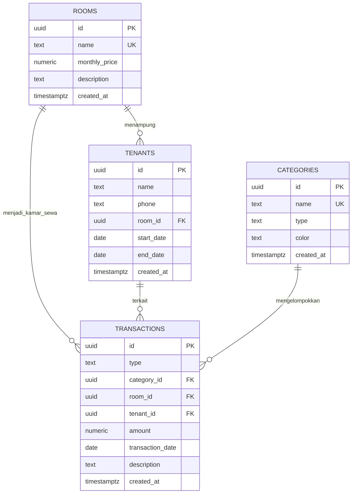

# Arus Kos

Aplikasi web pencatatan arus kas sederhana untuk pengelolaan kos. Catat pemasukan sewa kamar dan pengeluaran operasional seperti air, listrik, kebersihan, keamanan, dan perbaikan. Dashboard merangkum pemasukan, pengeluaran, saldo bersih per bulan, transaksi terbaru, dan pengeluaran berdasarkan kategori.

## Fitur

- CRUD lengkap untuk kamar, penghuni, operasional, dan transaksi.
- Kaitkan penghuni ke kamar serta transaksi ke kategori dan penghuni.
- Filter transaksi berdasarkan bulan dan pencarian teks.
- Lihat total pengeluaran per kategori operasional dan cetak laporan bulanan atau simpan sebagai PDF.
- Masukkan nominal dengan pemisah ribuan Indonesia, contohnya `1.500.000`.
- Kategori pemasukan dan pengeluaran dijaga agar jenisnya sesuai dengan transaksi.
- Antarmuka responsif dalam Bahasa Indonesia, dengan nilai uang dalam Rupiah.

## Struktur

```text
frontend/
  index.html
  styles.css
  app.js
backend/
  database.sql
  app.js
docs/
    skema-database.md
README.md
```

Untuk penjelasan rinci tiap tabel, relasi, aturan validasi, dan RLS, lihat [Dokumentasi Skema Database](docs/skema-database.md).

## ERD



`tenants.room_id`, `transactions.category_id`, `transactions.room_id`, dan `transactions.tenant_id` boleh kosong. Jika kamar, penghuni, atau kategori terkait dihapus, transaksi historis tetap tersimpan dan referensinya menjadi kosong.

Pada transaksi pemasukan, pilih kamar sewa untuk mengisi jumlah sesuai harga bulanan kamar. Jika ada penghuni aktif, penghuni tersebut ikut dipilih. Daftar kamar menunjukkan status terisi/kosong dan nama penghuni aktif.

Jalankan ulang `backend/database.sql` setelah pembaruan ini agar kolom `transactions.room_id` tersedia. Jika database sudah memiliki transaksi sebelum kolom tersebut ditambahkan, relasi kamar untuk transaksi lama dibiarkan kosong dan dapat diisi melalui fitur ubah transaksi.

## Menyiapkan Supabase

1. Buat project Supabase baru, lalu jalankan seluruh `backend/database.sql` di **SQL Editor**.
2. Buat akun admin di **Authentication > Users > Add user** dan tandai email sebagai terkonfirmasi. Aplikasi tidak menyediakan pendaftaran publik.
3. Nonaktifkan sign-up publik di pengaturan **Authentication** agar hanya akun admin yang dibuat dari dashboard dapat masuk.
4. Buka **Project Settings > API**. Salin **Project URL** dan **Publishable key**.
5. Di bagian atas `frontend/app.js`, ganti nilai konfigurasi berikut dengan milik project:

```js
const SUPABASE_URL = 'https://YOUR-PROJECT-REF.supabase.co';
const SUPABASE_PUBLISHABLE_KEY = 'YOUR_SUPABASE_PUBLISHABLE_KEY';
```

Publishable key memang digunakan di browser. Jangan pernah memasukkan `service_role` key ke frontend. Kebijakan RLS pada SQL membatasi data berdasarkan akun admin yang login.

Jika skema lama sudah pernah dijalankan dan berisi data, kolom `owner_id` yang baru ditambahkan tetap kosong untuk data lama. Setelah membuat admin, salin UUID akun dari **Authentication > Users**, lalu jalankan backfill untuk mengaitkan data lama ke akun tersebut:

```sql
update public.rooms set owner_id = 'ADMIN-USER-UUID' where owner_id is null;
update public.tenants set owner_id = 'ADMIN-USER-UUID' where owner_id is null;
update public.categories set owner_id = 'ADMIN-USER-UUID' where owner_id is null;
update public.transactions set owner_id = 'ADMIN-USER-UUID' where owner_id is null;
```

## Menjalankan aplikasi

Setelah URL dan publishable key diisi, buka `frontend/index.html` langsung di browser, lalu masuk menggunakan akun admin Supabase. CSS, JavaScript, autentikasi, dan CRUD berjalan dari browser; backend lokal tidak diperlukan untuk penggunaan ini. Jika browser membatasi permintaan lintas origin dari file lokal, jalankan server statis dengan Node.js versi 18 atau lebih baru dari PowerShell di folder project:

```powershell
node backend/app.js
```

Lalu buka `http://localhost:3000`. Tidak diperlukan `package.json`, `env.example`, atau instalasi paket.

## Keamanan

Publishable key aman untuk dipakai di frontend karena ia bukan secret. Perlindungan data berasal dari Supabase Auth dan policy RLS, bukan dari kerahasiaan key. Jangan aktifkan pendaftaran publik untuk project ini, dan jangan pernah menggunakan `service_role` key di browser.
